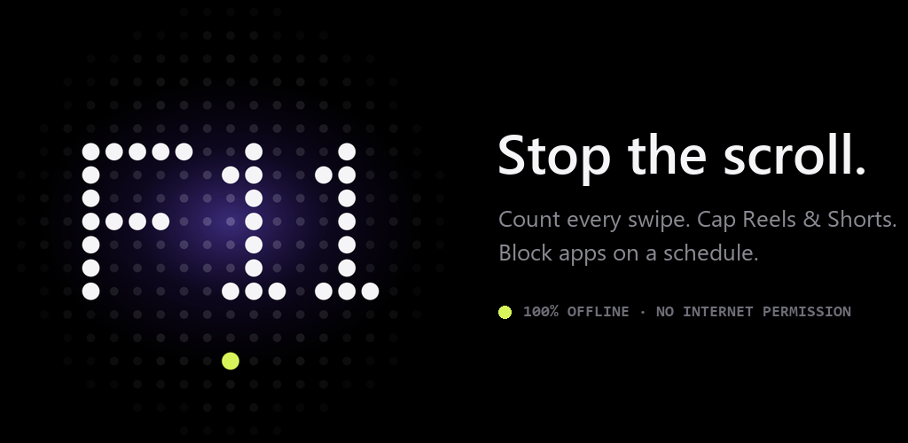

<p align="center">
  
</p>

# F11 · Anti-BrainRot Guard

**One life. Stop the scroll.** F11 is an Android app that blocks distracting apps on a schedule and, with its optional F11 Shield plugin, counts every swipe you make in short-form video feeds and caps Reels and Shorts with a swipe budget. It runs **100% offline**: neither app has internet permission, so nothing they see can ever leave your phone.

<p align="center">
  
</p>

## Features

| | | Needs |
|---|---|---|
| **Max Focus** | Block guarded apps entirely: feeds, DMs, stories and videos. | F11 |
| **Focus schedules** | Max Focus turns on by itself (Work, Study, Sleep…). A running schedule can't be ended, edited or deleted. | F11 |
| **Intentional friction** | Loosening any rule takes a 30 s pause and typing a hard-hitting line. | F11 |
| **Report** | 7 / 30 day history, daily average, busiest day, shields raised, focus streak. | F11 |
| **Scroll awareness** | A live counter pill at the top of Reels and Shorts. Swipes are counted even with the guard off. | F11 + Shield |
| **Swipe budget** | Allow *N* swipes per session; the next one raises a full-screen shield for a cooldown. | F11 + Shield |
| **Feeds only** | Only Reels / Shorts / TikTok / Spotlight count. DMs, stories and regular YouTube videos stay open. | F11 + Shield |
| **Block completely** | Optionally block Reels & Shorts on the first swipe. | F11 + Shield |

Guarded apps: Instagram (Reels), YouTube (Shorts), TikTok, Facebook (Reels), Snapchat (Spotlight).

## Two apps: F11 and the optional F11 Shield

F11 comes as two apps signed with the same developer key:

| | **F11** | **F11 Shield** (optional plugin) |
|---|---|---|
| What it adds | Max Focus, focus schedules, friction, report | Reels/Shorts swipe counting, swipe budget, block completely, live counter |
| Permissions | Usage access, Display over other apps, notifications | Accessibility |
| Installs from a browser download? | Yes | May be blocked by Play Protect in some countries (see [Troubleshooting](#troubleshooting)) |
| Affects UPI payment apps? | No | Some pause payments while it's on |
| Stores data | Yes: all settings and counts | No: it reads limits from F11 and reports swipes back to it |

Why two? Google Play Protect blocks downloaded apps that use the Accessibility API, and payment apps refuse to work while one is on ([Google's developer guidance](https://developers.google.com/android/play-protect/warning-dev-guidance)). Keeping Accessibility in a separate, optional plugin means F11 itself always installs and never gets in the way of payments.

## Setup guide

Requires Android 8.0 or later. Both downloads are on the [latest release](https://github.com/1elevenop/F11-AntiBrainRot/releases/latest).

### Step 1: install F11

1. On your phone, download the **F11** APK from the release page and open it.
2. If Android asks, allow your browser or file manager to **install unknown apps**, then tap **Install**.
3. Open **F11**.

### Step 2: let F11 block apps

The **Let F11 block apps** card on the home screen asks for two permissions. Max Focus and focus schedules need both.

1. Tap **Usage access**, read the disclosure, tap **Agree and continue**, then switch **F11** on. This tells F11 which app is open, by name only.
2. Tap **Display over apps** and switch **F11** on. This lets F11 cover a guarded app with its shield.
3. Allow notifications when asked. While Max Focus or a schedule is active, F11 shows an ongoing notification so you can see it's watching.

The card disappears once both permissions are granted.

### Step 3: set your rules

1. Open **Settings** (top right on the home screen).
2. Under **Guarded feeds**, choose which apps F11 guards.
3. Under **Focus schedule**, tap **+ Add focus time** to block guarded apps at set times, or turn on **Max Focus** from the home screen to block them now.

To test it, turn on Max Focus and open Instagram: the shield covers it, and **Go home** takes you to the home screen. Turning Max Focus off goes through the 30-second pause.

### Step 4 (optional): add F11 Shield for Reels and Shorts

1. Download the **F11 Shield** APK from the same release and install it. If Play Protect blocks it, see [Troubleshooting](#troubleshooting).
2. Open **F11 Shield** and tap **Turn on**. Read the disclosure and tap **Agree and continue**.
3. In Accessibility settings, open **Downloaded apps → F11 Shield** and switch it on.
4. If the switch is greyed out or Android says **"Restricted setting"**:
   1. Go back to F11 Shield and tap **Open App info** (or open **Settings → Apps → F11 Shield**).
   2. Tap **⋮** at the top right and choose **Allow restricted settings**.
   3. Return to Accessibility settings and switch F11 Shield on.
5. Back in **F11 → Settings**, the **Reels & Shorts** section is now unlocked: set your swipe budget and cooldown, or block Reels and Shorts completely.

To test it, swipe a few Reels: the counter pill appears at the top and F11's home screen counts up.

### Updating from F11 1.0

Install the new F11 over the old one. Your history, settings and schedules are kept. F11 no longer appears under Accessibility: grant the two permissions from Step 2, then install F11 Shield (Step 4) to get swipe counting back.

## Troubleshooting

**"App blocked to protect your device" (Google Play Protect).** In some countries, including **India**, Play Protect blocks downloaded apps that use an accessibility service. This affects only **F11 Shield**, not F11, and the dialog has no "install anyway" option. Your options, best first:

1. **Google Play:** not available there yet. Apps from Google Play aren't affected.
2. **USB install from a computer:** with [platform-tools](https://developer.android.com/tools/releases/platform-tools) installed and USB debugging on, run `adb install F11-Shield-v1.0.apk`.
3. **Skip it:** Max Focus and focus schedules work without the plugin.

**"Payments blocked" in a UPI app.** Some payment apps refuse to work while any downloaded app has Accessibility on. Turn **F11 Shield** off in Accessibility settings, restart the phone, pay, then turn it back on. F11 itself doesn't cause this.

**"File might be harmful" in Chrome.** Chrome shows this for every APK download. Tap **Download anyway**.

**The shield doesn't appear during Max Focus.** Check that **Usage access** and **Display over other apps** are still on for F11 (the home screen card comes back if not), and that the app is switched on under **Guarded feeds**. Some phones also stop background apps: allow F11 to run in the background in its battery settings.

**"F11 Shield stopped".** Android sometimes switches the service off after an update. Open Accessibility settings and turn F11 Shield off and on again.

**Is my APK genuine?** Compare its SHA-256 checksum and signing certificate fingerprint with the ones on the release page. Both apps must be signed with the same key, or F11 refuses to talk to the plugin.

## Privacy

- **No `INTERNET` permission** in either app. Verifiable in [F11's manifest](app/src/main/AndroidManifest.xml) and [the plugin's](shield/src/main/AndroidManifest.xml).
- F11 uses Usage access only for **which app is in front** (package name), and draws its shield with "Display over other apps".
- The plugin's Accessibility service reads only **package names and view resource IDs**, never on-screen text, messages or passwords. It doesn't record the screen.
- The plugin talks only to F11 on the same phone, through a provider protected by a signature permission: only apps signed with F11's key can use it.
- No microphone, camera or location permission is requested.
- Only daily counts and your settings are stored, in F11's private app storage. See [PRIVACY.md](PRIVACY.md).

## Build

Requirements: Android SDK (platform 35), JDK 17+ (Android Studio's bundled JBR works).

```bash
./gradlew :core:testDebugUnitTest :app:assembleDebug :shield:assembleDebug
```

The APKs are written to `app/build/outputs/apk/debug/app-debug.apk` (F11) and `shield/build/outputs/apk/debug/shield-debug.apk` (F11 Shield). Install both:

```bash
adb install -r app/build/outputs/apk/debug/app-debug.apk
```

```bash
adb install -r shield/build/outputs/apk/debug/shield-debug.apk
```

Release builds (`assembleRelease`) are signed from `keystore.properties` (git-ignored) or the `F11_STORE_FILE`, `F11_STORE_PASSWORD`, `F11_KEY_ALIAS` and `F11_KEY_PASSWORD` environment variables. Both apps use the same key; see [`buildSrc/src/main/kotlin/F11Signing.kt`](buildSrc/src/main/kotlin/F11Signing.kt).

| | |
|---|---|
| Packages | `com.f11.app` (F11) · `com.f11.shield` (F11 Shield) |
| SDK | min 26 · target 35 · compile 35 |
| Stack | Kotlin 2.2, Jetpack Compose (Material 3), AGP 9.1, Gradle 9.9 |
| Tests | JUnit in `core`: scroll limiter, history & streaks, friction lines, focus schedules, feed detection |

## Project layout

```text
core/      Shared by both apps
  data/      F11Settings, ShieldContract, ShieldStatus, History, FocusSchedule, FrictionLines, TargetAppsConfig
  service/   ScrollTracker, OverlayController (the shield), CounterOverlay
  ui/        Theme, components, disclosure dialog
app/       F11 (com.f11.app)
  data/      PreferencesManager: the only store of settings and counts
  focus/     FocusWatchService (Max Focus without Accessibility), BootReceiver
  shield/    ShieldProvider: the plugin's signature-protected way in
  ui/        Home, History, Settings, setup cards, friction & schedule dialogs
shield/    F11 Shield plugin (com.f11.shield)
             F11AccessibilityService, ShieldClient, StatusActivity
buildSrc/  Shared release signing
media/     Play Store icon, feature graphic, store screenshots, listing copy
art/       Logo artwork
```

## Media

Everything for a store listing lives in [`media/`](media): the 512 px icon, the 1024×500 feature graphic, seven 1080×1920 framed screenshots, the raw captures, [listing copy](media/store-listing.md) and the 1280×640 [GitHub social preview](media/github-social-preview.png).

## License

[MIT](LICENSE) © 2026 Jaydeep G. (1elevenop)
