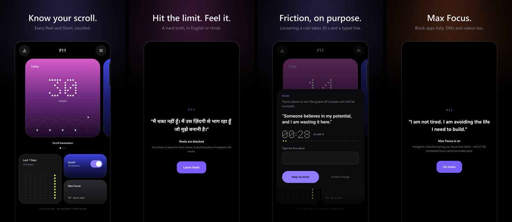

<p align="center">
  
</p>

# F11 · Anti-BrainRot Guard

**One life. Stop the scroll.** F11 is an Android app that counts every swipe you make in short-form video feeds, caps Reels and Shorts with a swipe budget, and blocks whole apps on a schedule. It runs **100% offline**: the app has no internet permission, so nothing it sees can ever leave your phone.

<p align="center">
  
</p>

## Features

| | |
|---|---|
| **Scroll awareness** | A live counter pill at the top of Reels and Shorts. Swipes are counted even with the guard off. |
| **Swipe budget** | Allow *N* swipes per session; the next one raises a full-screen shield for a cooldown. |
| **Feeds only** | Only Reels / Shorts / TikTok / Spotlight count. DMs, stories and regular YouTube videos stay open. |
| **Block completely** | Optionally block Reels & Shorts on the first swipe. |
| **Max Focus** | Block guarded apps entirely: feeds, DMs, stories and videos. |
| **Focus schedules** | Max Focus turns on by itself (Work, Study, Sleep…). A running schedule can't be ended, edited or deleted. |
| **Intentional friction** | Loosening any rule takes a 30 s pause and typing a hard-hitting line, plus an optional spoken line (on-device speech). |
| **English & हिन्दी** | Strong lines in English and Hindi (with masculine/feminine verb forms). |
| **Report** | 7 / 30 day history, daily average, busiest day, shields raised, focus streak. |

Guarded apps: Instagram (Reels), YouTube (Shorts), TikTok, Facebook (Reels), Snapchat (Spotlight).

## Privacy

- **No `INTERNET` permission.** Verifiable in [`AndroidManifest.xml`](app/src/main/AndroidManifest.xml).
- The Accessibility service reads only **package names and view resource IDs**, never on-screen text, messages or passwords. It doesn't record the screen.
- The shield is drawn with `TYPE_ACCESSIBILITY_OVERLAY`; `SYSTEM_ALERT_WINDOW` is not requested.
- The optional voice step uses Android's **on-device** recognizer only; audio is never stored or sent.
- Only daily counts and your settings are stored, in private app storage. See [PRIVACY.md](PRIVACY.md).

## Build

Requirements: Android SDK (platform 35), JDK 17+ (Android Studio's bundled JBR works).

```bash
./gradlew testDebugUnitTest assembleDebug
```

The APK is written to `app/build/outputs/apk/debug/app-debug.apk`. Install it, open F11, tap **Enable**, read the disclosure and turn on **F11 Shield** in Accessibility settings.

| | |
|---|---|
| Package | `com.f11.app` |
| SDK | min 26 · target 35 · compile 35 |
| Stack | Kotlin 2.2, Jetpack Compose (Material 3), AGP 9.1, Gradle 9.9 |
| Tests | JUnit: scroll limiter, history & streaks, friction lines, focus schedules, feed detection |

## Project layout

```text
app/src/main/java/com/f11/app/
├── MainActivity.kt
├── data/       PreferencesManager, History, FocusSchedule, FrictionLines, TargetAppsConfig
├── service/    F11AccessibilityService, ScrollTracker, OverlayController, CounterOverlay
└── ui/         F11App, Home/History/Settings screens, friction & schedule dialogs, theme
media/          Play Store icon, feature graphic, store screenshots, listing copy
art/            Logo artwork
```

## Media

Everything for a store listing lives in [`media/`](media): the 512 px icon, the 1024×500 feature graphic, seven 1080×1920 framed screenshots, the raw captures and [listing copy](media/store-listing.md).
